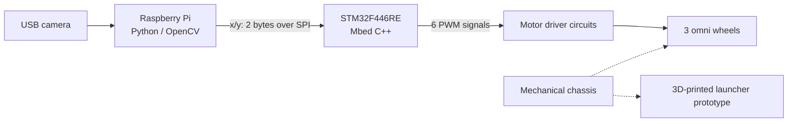

# Roboso — Project Overview

画像を読むソフトウェアと、実機を動かす電子回路・機構を結び付けた、4名チームのロボット開発プロジェクトです。Raspberry Pi、STM32、モータドライバ、3輪オムニホイール・シャーシ、3Dプリント発射機構を一つの試作機に統合しました。

## どのような問題に取り組んだか

ボールを見つける処理と、モータへ信号を出す処理では、必要な計算資源と時間特性が異なります。そこで、画像処理をRaspberry Pi、PWM出力をSTM32に分担し、画面中心からの偏差をSPIで受け渡しました。これに加え、車体・発射機構・基板・電源を実機に組み合わせる作業が必要でした。

最終目標は「検出・追従・回収・発射」の一連動作です。公開資料で確認できる到達点は、画像処理と通信・駆動のコード、車体と発射機構の試作、基本動作の定性的な報告です。回収機構の制御は未完了で、投擲精度・長時間安定性とv3制御は検証が残っています。

## プロジェクトを構成する6つの領域

| 領域 | 開発内容 | 読み始める場所 |
|---|---|---|
| 画像入力・認識 | 別スレッドでの撮像、HSV領域抽出、輪郭からの偏差計算 | [Python](python/README.md) |
| 組み込み制御 | SPIスレーブ受信、3輪PWM、3世代の制御ロジック | [Mbed](mbed/README.md) |
| 電子回路 | STM32拡張基板、モータドライバ配線基板、電源系の検討 | [Electronics](electronics/README.md) |
| 機械設計 | 120°配置のオムニ車体、ラック・ピニオン式発射機構 | [Hardware](hardware/README.md) |
| システム統合 | 信号・電力・機構のインターフェース、故障の切り分け | [統合手順](hardware/integration.md) |
| 開発・検証 | 当時の実験記録、現在の静的検査、今後の実機試験 | [開発ガイド](docs/development-guide.md) |

## 画像から物理出力まで

発射機構は機械的な試作として示しています。公開ファームウェアには発射・回収を実行する処理がなく、図はそれらのソフトウェア連動を示しません。

## 設計上の判断と得られた論点

| 判断 | 狙い | 実装から見える課題 |
|---|---|---|
| PiとMCUを分離 | 画像処理とPWM出力の責務を分ける | 通信途絶・目標消失時の停止条件が必要 |
| HSVで黄色領域を抽出 | 学習モデルを使わない小さな処理系 | 照明・類似色への依存と複数目標の選択 |
| 偏差だけを2 byteで転送 | インターフェースを小さくする | 同期・誤り検出・鮮度情報がない |
| 最新フレームをLockで共有 | 撮像と処理を並行に進める | フレーム年齢と読み取り失敗の扱い |
| 制御ロジックを段階的に変更 | 閾値からP/PID形式へ検討を進める | 分岐上書き、時間基準、実機検証が残る |
| 機構を3Dプリントで試作 | 形状を変更しながら組付けを確かめる | 寸法・材料・印刷条件の原記録が不足 |

## 本人の貢献

本人は4名チームのリーダーとして進捗・日程・リソースとサブシステム間の調整を担当し、発射機構の協働設計・試作、電源・基板・配線、SPI・画像処理・モータ制御の実装に関与しました。発射機構は約11回の改修が報告されています。ロボット全体と受賞はチームの成果です。

担当範囲は[チームと本人の貢献](docs/12-team-contribution.md)、主張の根拠は[エビデンスマップ](docs/15-evidence-map.md)にまとめています。

## 読み方

1. このページで構成と到達点を把握する。
2. [Python](python/README.md)と[Mbed](mbed/README.md)から実際のコードへ進む。
3. [回路](electronics/README.md)と[機構](hardware/README.md)で物理構成を確認する。
4. [故障分析](docs/11-troubleshooting.md)と[試験計画](docs/10-verification.md)で設計上の課題を確認する。

CAD/EDAの原本、製造データ、実験生データは未提供です。掲載画像は報告からの抜粋で、元報告全体やメンバーの個人情報は公開していません。[媒体索引](media/README.md) / [再利用条件](NOTICE.md)
