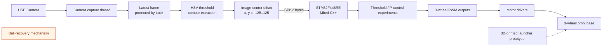

# Roboso | 画像認識から実機制御までを統合した3輪オムニロボット

**End-to-End System Architecture / Embedded Control / Computer Vision / Hardware-Software Co-design**

USBカメラの画像から色領域を検出し、Raspberry PiからSTM32へのSPI通信を介して3輪駆動系を制御する、4名チームの実機開発記録です。大学の「ロボット創造実験」（2024年度）で開発しました。リポジトリ所有者が従来公開している情報では、チームとして最優秀賞（2025年1月）を受賞したとされていますが、一次資料は本リポジトリに未収録です（[根拠の境界](docs/14-award.md)）。

本人はチームリーダーとして、進行管理と統合に加え、機構・回路・プログラムを横断して担当しました。このリポジトリでは、実装済み、試作済み、設計目標、未完了・未検証を明確に分けています。

> [!IMPORTANT]
> 本リポジトリは実験時点のコードと資料を、作品集向けに整理したものです。回収機構は未完了、投擲精度と長時間稼働は未検証、STM32 v3は未テストです。公開コードにはchecksum、再送、queueは実装されていません。

## プロジェクト概要

| 項目 | 内容 |
|---|---|
| 対象 | 黄色ボールの画像検出と移動制御 |
| 上位系 | Raspberry Pi / Python / OpenCV / USBカメラ（型番は資料内で表記不一致） |
| 下位系 | STM32F446RE / Mbed C++ / 3輪分のPWM出力 |
| 通信 | SPI、2 byteの符号付き画面偏差 `x, y` |
| 機構 | 120°配置の3輪オムニホイール・シャーシ、3Dプリント発射機構の試作 |
| 開発体制 | 4名チーム、本人はリーダー兼機構・回路・プログラム担当 |
| 外部結果 | 所有者の従来公開情報によるチーム最優秀賞（2025年1月、一次資料未収録） |

## システムの実装範囲

画像取得とモータ制御を別の計算機に分け、カメラ処理の負荷がMCU側のPWM出力を直接占有しない構成にしています。一方で、公開ファームウェアは任意方向のオムニホイール運動学計算ではなく、前後進と旋回を切り替える段階的な制御です。

詳細: [システムアーキテクチャ](docs/01-system-architecture.md)

## 状態マトリクス

| サブシステム | 設計目標 | 公開資料で確認できるもの | 状態 |
|---|---|---|---|
| 画像処理 | ボールを検出し中心偏差を生成 | HSVマスク、輪郭、最小包囲円、`x/y`算出 | 実装・単体実験記録あり |
| マルチスレッド | 撮像と処理を分離 | 撮像スレッド + `threading.Lock` + メイン処理 | 実装あり |
| SPI | Raspberry PiからSTM32へ偏差を送信 | `x, y`の2 byte送受信 | 実装あり、フレーム健全性機能なし |
| シャーシ制御 v1 | 偏差に応じた追従 | 閾値制御 | 実装あり、分岐上書きの問題あり |
| シャーシ制御 v2 | PID形式の制御 | `Kp=0.015`, `Ki=Kd=0` | 実質P制御、検証範囲は不明 |
| シャーシ制御 v3 | I/D項、積分制限、変化率制限 | ソースコード | **未テスト** |
| 発射機構 | ボールの反復投擲 | CAD・3Dプリント試作・基本動作の報告 | 試作、精度と連続稼働は未検証 |
| 回収機構 | ボールをロボットに取り込む | 設計イメージと試作ハードウェア | **未完了** |

全項目の根拠: [エビデンスマップ](docs/15-evidence-map.md)

## 実装の見どころ

- 画像入力から物理出力までのエンドツーエンドな分割設計
- Pythonの撮像スレッドと最新フレーム共有
- OpenCVによる軽量な色領域検出（機械学習ではありません）
- 2 byte SPIプロトコルとSTM32のスレーブ処理
- 閾値制御 → P制御相当 → 未テストのPID案という制御ロジックの変遷
- 機構、PCB、電源、通信、制御をまたぐ統合と故障分析

## ドキュメント

| 分野 | ドキュメント |
|---|---|
| 全体 | [ドキュメント索引](docs/README.md) / [システムアーキテクチャ](docs/01-system-architecture.md) |
| 機構 | [3輪オムニホイール・シャーシ](docs/02-omni-chassis.md) / [3Dプリント発射機構](docs/03-launcher-mechanism.md) |
| 電気 | [STM32拡張・モータドライバPCB](docs/04-electronics-pcb.md) / [電源設計](docs/05-power.md) |
| 通信・ソフト | [SPIプロトコル](docs/06-spi-protocol.md) / [画像処理](docs/07-vision-pipeline.md) / [マルチスレッド](docs/08-concurrency.md) |
| 制御・評価 | [制御の変遷](docs/09-control-evolution.md) / [試験と検証](docs/10-verification.md) / [故障分析](docs/11-troubleshooting.md) |
| プロジェクト | [チームと本人の貢献](docs/12-team-contribution.md) / [既知の制約](docs/13-known-limitations.md) / [受賞](docs/14-award.md) |

## ソースコード

| パス | 役割 | 状態 |
|---|---|---|
| [`python/spi/camera_spi4.py`](python/spi/camera_spi4.py) | 撮像、黄色検出、偏差計算、SPI送信 | 主なRaspberry Pi側実装 |
| [`python/camera/distance_camera_multithreading.py`](python/camera/distance_camera_multithreading.py) | 撮像スレッドと偏差計算の初期試作 | SPIなしの初期版 |
| [`mbed/mbed_ball_tracking.cpp`](mbed/mbed_ball_tracking.cpp) | 閾値制御 | v1 |
| [`mbed/mbed_ball_tracking_v2.cpp`](mbed/mbed_ball_tracking_v2.cpp) | PID形式（`Ki=Kd=0`） | v2、実質P制御 |
| [`mbed/mbed_ball_tracking_v3.cpp`](mbed/mbed_ball_tracking_v3.cpp) | I/D項、積分制限、出力変化制限 | **未テスト** |

## 再現に必要な環境

- Raspberry Pi、USBカメラ、SPIが有効なLinux環境（報告内ではPi 4 / 4BとPi 5の表記が混在）
- Python 3、OpenCV、NumPy、`spidev`
- STM32F446RE、Mbed対応ツールチェーン
- レポート内の配線と公開コードのピン定義に合う実機

現在はハードウェア、Mbedプロジェクト設定、元のCAD/EDAファイルが公開されていないため、第三者がこのリポジトリだけで完全再現できる状態ではありません。

## 資料・知的財産・プライバシー

- 元の46ページ報告書は公開していません。
- 掲載画像は報告書から必要部分だけを抽出し、学籍番号、氏名、他メンバーの情報を含むページは除外しています。
- 元のCAD・PCB設計データはこのリポジトリには含まれず、画像から再作成したファイルもありません。
- チーム共同成果のため、再利用条件は [`NOTICE.md`](NOTICE.md) を参照してください。

既存の公開動画: [YouTube](https://youtu.be/YpfJDm7KIg8)
