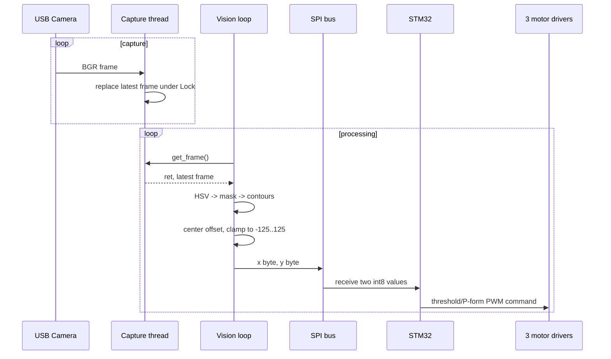

# 01. システムアーキテクチャ

## 設計の狙い

カメラ画像の処理とモータのPWM出力を同一の処理系に押し込まず、上位のRaspberry Piと下位のSTM32に分離しました。上位系は「何を、画面中のどこに見つけたか」を計算し、下位系はその偏差を「どの方向に、どの程度駆動するか」に変換します。

## 責務の分割

| 層 | 実装 | 責務 | 公開根拠 |
|---|---|---|---|
| センシング | USBカメラ | BGR画像の取得 | 撮像コードと実験画像 |
| 認識 | Raspberry Pi / OpenCV | HSV変換、色領域抽出、輪郭検出 | [`camera_spi4.py`](../python/spi/camera_spi4.py) |
| 目標表現 | Raspberry Pi / Python | 画面中心からの `x, y` 偏差 | [`camera_spi4.py`](../python/spi/camera_spi4.py) |
| ノード間通信 | SPI | 2 byteの偏差転送 | PythonとMbedの両実装 |
| 制御 | STM32F446RE / Mbed C++ | 閾値判定、P制御形式の実験 | [`mbed/`](../mbed) |
| アクチュエーション | PWM / モータドライバ | 3輪の正逆回転入力 | Mbedのピン定義とモータ関数 |
| 機構 | 3輪オムニホイール・シャーシ、発射機構 | 移動とボール発射の試作 | 報告内のCAD・写真 |

## 実際のデータフロー

実装は「1フレームに対し必ず1コマンド」ではありません。面積500 pixelを超える輪郭が複数あれば、同じフレームから複数のSPI転送が発生します。逆に輪郭がない場合は、「目標消失」を示すコマンドは送られません。

## アーキテクチャ上のトレードオフ

| 選択 | メリット | 現時点の制約 |
|---|---|---|
| Pi / MCUの分離 | 画像処理と駆動出力の責務を分けられる | SPIエラー時のフェイルセーフがない |
| 色しきい値方式 | 学習モデル不要で軽量 | 照明、反射、類似色に弱い |
| 2 byteフレーム | 実装が小さく、デバッグしやすい | 同期、種別、シーケンス、CRCを持たない |
| 最新フレーム共有 | 古いフレームを蓄積しない | フレーム欠落数や処理遅延を計測していない |
| 受信駆動型制御 | 受信と制御処理が単純 | 制御周期は固定されず、`dt=1 ms`の根拠がない |

## 範囲外と未検証

- Linuxカーネル、デバイスドライバ、ROS / ROS 2の実装ではありません。
- コンピュータビジョンは従来型の色領域処理であり、AI / MLとしては扱いません。
- エンドツーエンド遅延、ジッタ、フレームレート、SPI転送成功率の測定値はありません。
- 実機の完全な配線図、ビルド手順、ファームウェアプロジェクト設定は現存の公開資料に含まれません。

