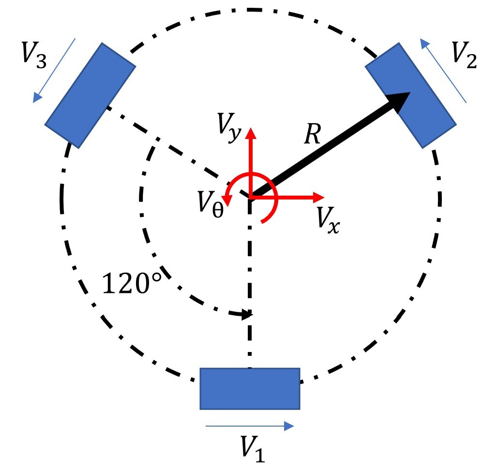

# 02. 3輪オムニホイール・シャーシ

## 機械構成

3個のオムニホイールをシャーシ外周に120°間隔で配置しています。報告では車体中心から車輪までの距離を `R = 173 mm` とし、車体座標の並進速度と角速度から各車輪速度を求める設計式を示しています。

$$
\begin{bmatrix}V_1\\V_2\\V_3\end{bmatrix}=
\begin{bmatrix}
1 & 0 & R\\
-\frac{1}{2} & \frac{\sqrt{3}}{2} & R\\
-\frac{1}{2} & -\frac{\sqrt{3}}{2} & R
\end{bmatrix}
\begin{bmatrix}V_x\\V_y\\V_\theta\end{bmatrix}
$$

### 重要な実装境界

上の運動学は報告にある設計説明です。現在の公開ファームウェアに、`Vx, Vy, Vtheta` から連続的な3輪出力を求める行列演算はありません。実装は `straight`、`back`、`left`、`right`、`stop` の個別動作を切り替える方式です。

## ピン割当て

| 対象 | 入力1 | 入力2 | 公開コード上の用途 |
|---|---|---|---|
| 左輪 | `PC_8` | `PC_6` | 前後進・旋回 |
| 右輪 | `PA_9` | `PA_8` | 前後進・旋回 |
| 後輪 | `PB_3` | `PA_10` | 旋回 |
| 補助モータ1 | `PB_10` | - | 宣言のみ、出力なし |
| 補助モータ2 | `PB_5` | - | 宣言のみ、出力なし |

PWM周期は3版とも `0.001 s`（1 kHz）に設定されています。これはPWMキャリアの周期であり、制御ループが1 msで実行されることを保証する値ではありません。

## 動作とコードの対応

| 関数 | 左輪 | 右輪 | 後輪 | 意図 |
|---|---|---|---|---|
| `straight(speed)` | 駆動 | 駆動 | 更新なし | 前進 |
| `back(speed)` | 逆方向駆動 | 逆方向駆動 | 更新なし | 後進 |
| `left(speed)` | 同方向駆動 | 同方向駆動 | 同方向駆動 | 左旋回 |
| `right(speed)` | 反対側出力 | 反対側出力 | 反対側出力 | 右旋回 |

`straight` と `back` は後輪のPWMを更新しません。旋回命令の直後に前後進を呼ぶと、後輪に前の出力が残る可能性があります。実ドライバの電気的な入力真理表が公開されていないため、リポジトリ上では停止・ブレーキ動作まで断定できません。

## 実機で確認すべき項目

1. 各輪の正方向とPWM極性
2. `stop()` の2入力がcoast / brakeのどちらになるか
3. 旋回後の前後進で後輪出力が残るか
4. 各輪の同一dutyに対する速度差
5. 行列ベースの任意方向移動を導入する場合の座標系と符号

