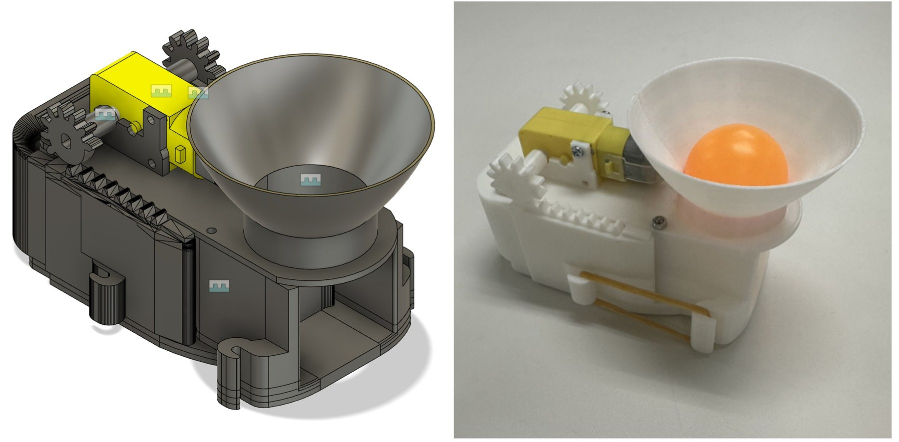
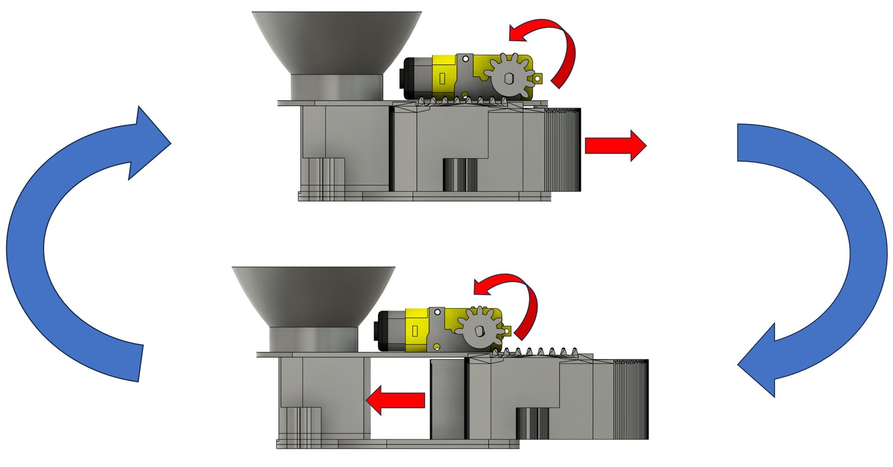

# 03. 3Dプリント発射機構

## 試作機構

ホッパ、DCギヤードモータ、ピニオン、ラック、スライダを3Dプリント部品にまとめた試作です。モータの回転をラックの直線運動に変換し、ホッパ下のボールを押し出すことを狙った構成です。

## 実装と検証の境界

| 項目 | 根拠 | 状態 |
|---|---|---|
| 形状設計 | 報告内のCAD図 | 設計記録あり |
| 3Dプリント試作 | 実物写真 | 試作品あり |
| 基本的な発射動作 | 報告結論の記述 | 定性的な確認 |
| 投擲精度 | 繰り返し測定データなし | **未検証** |
| 長時間・連続稼働 | 試験ログなし | **未検証** |
| ファームウェア連携 | 公開コードの補助モータは宣言のみ | **公開コードでは未確認** |

公開されているMbedコードには `motor1` と `motor2` のPWMオブジェクトがありますが、それらに対する `write()` はありません。したがって、「公開ソフトウェアが発射を自動制御する」とは主張しません。

## 力学モデルの扱い

報告PDF 17-19ページの力学式は、初期の設計検討としては残っていますが、単位と数値の整合性に問題があります。実測性能の根拠には使用しません。

| 論点 | 報告内の値 | 問題 |
|---|---|---|
| ばね定数 | `0.001 GPa` を `N/m` の定数として使用 | GPaは応力の次元であり、形状からばね定数への変換が必要 |
| 質量 | `0.06613 kg` → `0.002 kg` → `0.02 kg` | 同じ計算連鎖の中で値が一貫しない |
| 加速時間 | 定義は `0.015 s`、代入は `0.0015 s` | 10倍の差がある |
| 初速と飛距離 | `v0=0.5833 m/s`に対し `2.878 m` | 記載された条件で計算連鎖を再現できない |
| 比較曲線 | 後続図に約4 mの「actual curve」 | 計測方法、試行数、元データがない |

このため、投擲距離、発射速度、精度を実機性能として記載していません。次に行うべきは、力学モデルの単位整理、計測可能な入力値の定義、ハイスピードカメラまたは飛行距離の反復計測です。

## 現時点で不足する元データ

- CADソースファイル
- STL / STEPなどのエクスポート
- 寸法公差、材料、印刷条件
- モータ型式と実測トルク
- 連続投擲の試験ログ

