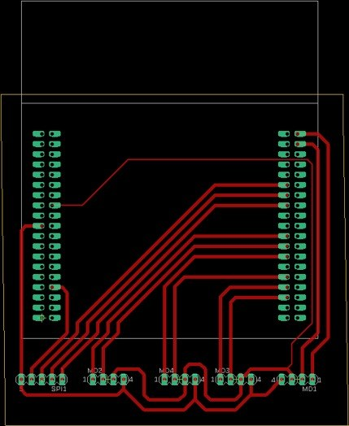
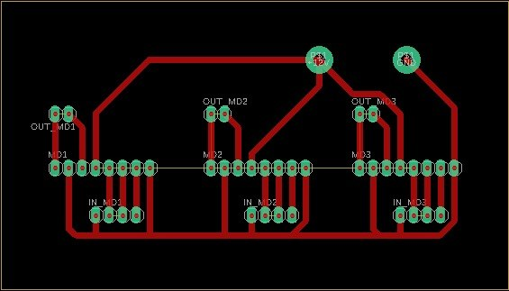

# 04. STM32拡張・モータドライバPCB

## 設計意図

ブレッドボード上の配線を減らし、STM32F446RE、SPI、PWM、複数のモータドライバを実機に固定しやすくすることが主な狙いです。報告にはSTM32拡張基板と、3系統のモータドライバ配線基板のレイアウト画像が残っています。

### STM32拡張基板

### モータドライバ基板

## ソフトウェアから確認できるインターフェース

| 機能 | STM32ピン | 備考 |
|---|---|---|
| SPI MOSI | `PA_7` | Raspberry Piからの受信 |
| SPI MISO | `PA_6` | `0xAA` / `0xBB` の返信に使用 |
| SPI SCLK | `PA_5` | 115200 Hz設定 |
| SPI SS | `PA_4` | スレーブ選択 |
| 左輪PWM | `PC_8`, `PC_6` | 2入力 |
| 右輪PWM | `PA_9`, `PA_8` | 2入力 |
| 後輪PWM | `PB_3`, `PA_10` | 2入力 |
| 補助PWM | `PB_10`, `PB_5` | 宣言のみ、未使用 |

## 公開範囲の限界

これらは「製造可能なPCBプロジェクト」ではなく、当時のレイアウト記録です。現在のリポジトリには次がありません。

- 回路図ソース
- EDAプロジェクト
- Gerber、ドリル、pick-and-placeデータ
- 部品の詳細なBOMと代替品条件
- DRC / ERCの実行結果
- パターン電流容量、温度上昇、ノイズの測定値

画像をトレースしてEDAファイルを作ったり、部品情報を推測で補完したりはしていません。

## 次の検証手順

1. 元のEDAデータをチームで確認し、公開できる範囲を決める
2. 回路図とレイアウトを照合する
3. 電源ネット、GND、モータ電流ループを確認する
4. ERC / DRC、短絡検査、無負荷通電を順に行う
5. モータ負荷時の電圧降下と温度上昇を記録する

