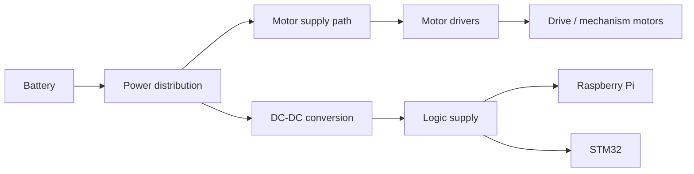

# 05. 電源設計

## 当時の設計意図

報告では、負荷変動の大きいモータ系とロジック系を安定して動作させるため、DC-DC変換と電源系の整理を行う方針が記述されています。モータ側の負荷変動がマイコンやRaspberry Piの電源品質に影響することを問題として認識していました。

この図は報告の設計意図を機能ブロックで表したもので、実際の電圧レール、ヒューズ、コネクタ、スイッチ配線を復元する回路図ではありません。

## 証拠と主張の限界

| 項目 | 確認できること | 確認できないこと |
|---|---|---|
| DC-DC | 安定化のために導入したという報告記述 | 型式、入出力電圧、実効電流、変換効率 |
| モータ系 | 複数モータとドライバを使用した設計 | 始動電流、ストール電流、実機最大電力 |
| 保護 | 電源の不安定性をリスクとして認識 | ヒューズ、逆接、過電流、低電圧、サーマル保護の実装 |
| 計測 | 基本動作を行ったというチーム記録 | オシロ波形、リップル、過渡降下、長時間温度 |

報告にはソフトウェア過電流保護に関する記述もありますが、現在の公開コードに電流検出、しきい値判定、PWM停止処理はありません。実装済みの保護機能とは扱いません。

## 再設計する場合の最低確認項目

- バッテリの定格、放電能力、低電圧カットオフ
- 各レールの最大・定常電流と余裕率
- モータ停動・始動時の過渡応答
- Raspberry PiとSTM32の低電圧リセット条件
- 保護素子の定格と実装位置
- モータ電流ループと通信GNDの配線
- 実機での温度上昇と連続運転時間
