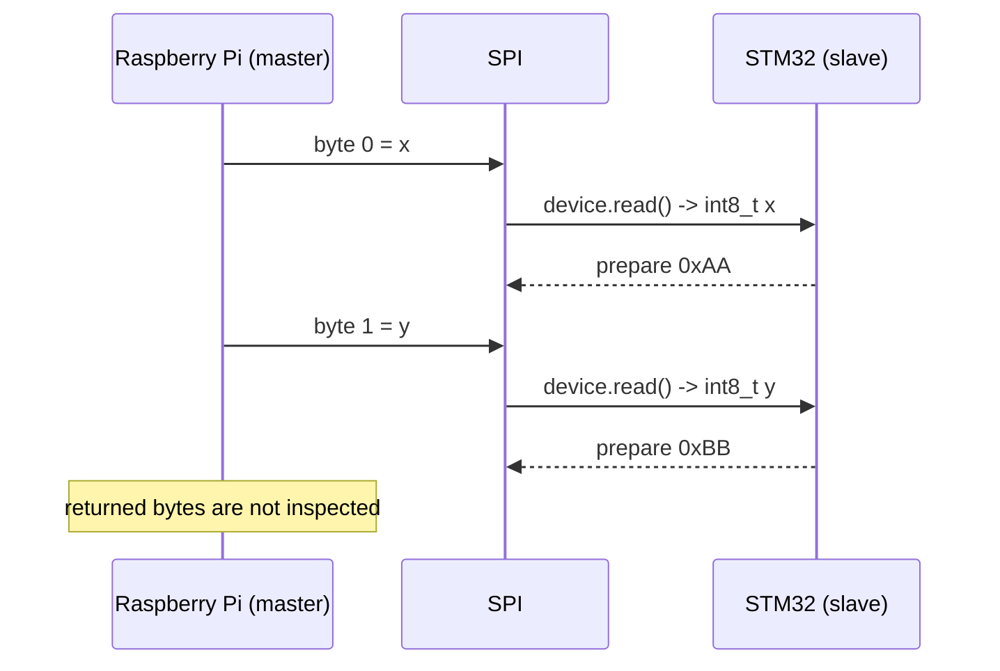
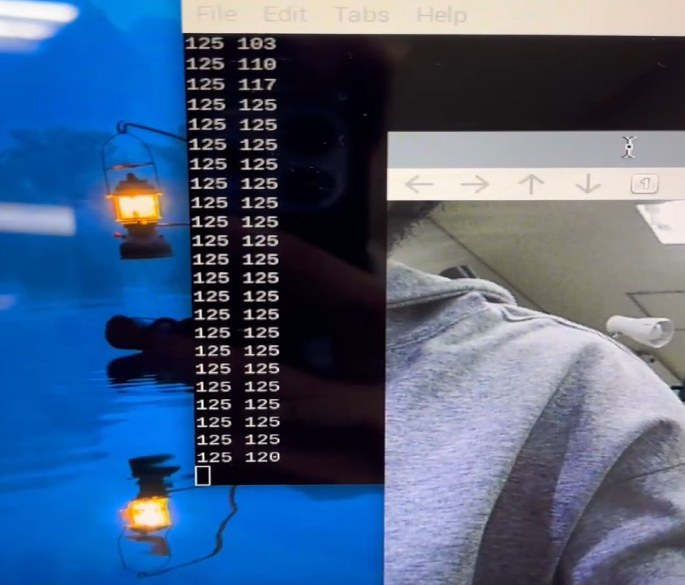

# 06. SPIプロトコル

## 公開コードで実装されているプロトコル

Raspberry Piをマスタ、STM32F446REをスレーブとし、検出した目標の画面中心からの偏差を2 byteで送信します。

| byte | 意味 | Python内の値 | ワイヤ上の値 | STM32側 |
|---:|---|---|---|---|
| 0 | x方向の偏差 | `-125..125` | `distance_x & 0xFF` | `int8_t distance_x` |
| 1 | y方向の偏差 | `-125..125` | `distance_y & 0xFF` | `int8_t distance_y` |

`& 0xFF` はPythonの符号付き整数を1 byteの2の補数表現に渡すための処理です。送信は `spi.xfer2([x, y])` の1回の呼び出しで行われます。

## バス設定

| 項目 | Raspberry Pi | STM32 |
|---|---|---|
| 役割 | master | slave |
| ポート | bus 0 / device 0 | `PA_7, PA_6, PA_5, PA_4` |
| 設定クロック | `max_speed_hz = 115200` | `frequency(115200)` |
| 転送API | `spi.xfer2()` | `receive()`, `read()`, `reply()` |

CPOL / CPHA、bit order、chip-selectのタイミング条件を固定する共通定義ファイルは公開されていません。実機再現時には両側の設定とロジックアナライザの波形を照合する必要があります。

## 報告の記述と現在の公開コード

| 機能 | 報告PDF 10ページの記述 | 公開コードでの確認 | 判定 |
|---|---|---|---|
| checksum / 誤り検出 | 記述あり | フィールドと計算のどちらもなし | 実装済みとは扱わない |
| 再送 | 記述あり | ホストは `xfer2()` の戻り値を無視 | 未実装 |
| 分割送信 | 記述あり | Pythonは2 byteを1回の `xfer2()` で送信 | 記述と不一致 |
| queue | マルチスレッド説明で記述 | `threading.Lock`による単一最新フレーム | queueなし |
| ACK | STM32は `0xAA`, `0xBB` を準備 | Raspberry Pi側の照合処理なし | 完了確認として未成立 |
| タイムアウト | - | 2 byte目の `receive()` を無期限に待機 | 未実装 |

v3の `is_valid_data(int8_t data)` は `-127..127` を確認しますが、入力型自体が `int8_t` のため、破損、byteズレ、古いデータを検出できません。`-128` を除外する範囲チェックであり、通信健全性チェックではありません。

## 実験記録

この画像は偏差値がコンソールに出力された定性的な記録です。パケット成功率、ACK一致率、遅延、ジッタを示す定量試験ではありません。

## 次期案（未実装）

改善する場合は、フレームヘッダ、シーケンス番号、状態、`x/y`、CRCを持つ固定長フレームにし、ホストが応答を照合する構成が候補です。これは将来案であり、現在の実装を示すものではありません。

