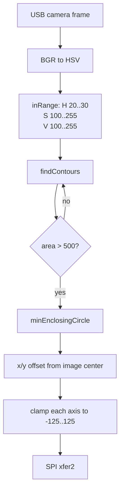
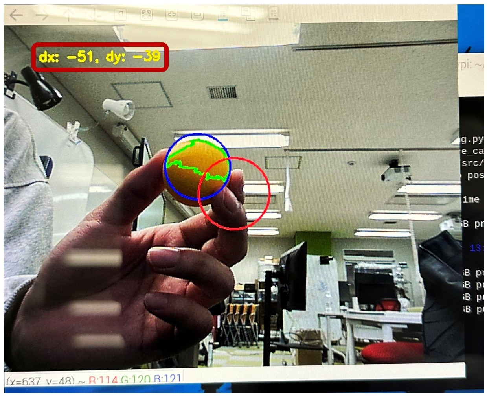

# 07. 画像処理パイプライン

## 実装済みの処理

[`camera_spi4.py`](../python/spi/camera_spi4.py) は、USBカメラから取得したBGR画像をHSVに変換し、黄色領域の輪郭から目標の位置を計算します。機械学習モデルは使用していません。

この画像は報告に残る定性的な実験記録です。この画面で使われた輪郭・円・偏差の描画コードは現在の公開リポジトリに含まれないため、同じ可視化UIを公開スクリプトからそのまま再現できるとは主張しません。HSV変換、輪郭抽出、最小包囲円、偏差計算そのものは公開コードで確認できます。

## 主なパラメータ

| 項目 | 値 | 意味 |
|---|---:|---|
| HSV lower | `[20, 100, 100]` | 黄色領域の下限 |
| HSV upper | `[30, 255, 255]` | 黄色領域の上限 |
| 輪郭面積 | `> 500` | 小さいノイズを除外 |
| 送信範囲 | `-125..125` | `int8_t`内に収めるための飽和 |
| 転送前待機 | `0.05 s` | 輪郭を1つ処理するごとに実行 |

これらは当時の実験パラメータであり、異なるカメラ、照明、露出、ボールでの適用性は検証されていません。

## 初期試作との差

[`distance_camera_multithreading.py`](../python/camera/distance_camera_multithreading.py) はSPIを持たない初期試作です。コード上のコメントは「黒色」を対象にしていますが、実際のHSV範囲は彩度 `0..43`、明度 `46..220` で、低彩度の灰色領域も広く含みます。このため、この試作を精密な黒色検出とは呼びません。

## 故障モード

| 状態 | 現在の挙動 | リスク |
|---|---|---|
| 目標がない | SPI送信なし | STM32が前回のPWMを維持する可能性 |
| 大きな輪郭が複数 | 全ての輪郭に対して順番に送信 | 最後に処理した輪郭が実質的な指令になる |
| カメラ読み取り失敗 | 前の `ret/frame` をクリアしない | 古いフレームを繰り返す可能性 |
| 照明変化 | 固定HSV範囲 | 未検出または誤検出 |
| 部分遮蔽・反射 | 最小包囲円を使用 | 中心が実物の中心とずれる |

## 次の実装候補（未実装）

- 最大輪郭または時系列で最も整合する1目標の選択
- 目標消失フラグと明示的な停止コマンド
- morphologyによる小領域の除去
- 検出信頼度、処理時間、フレームIDのログ
- 実験場所ごとのHSV調整と、固定値をコードから分離した設定ファイル

