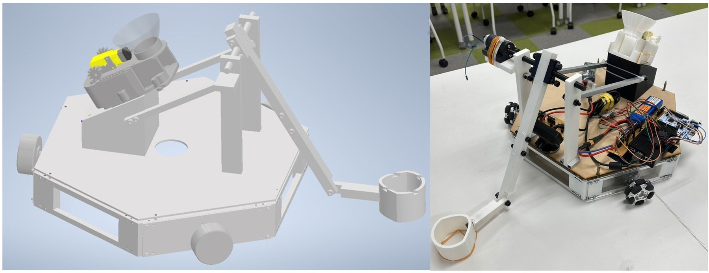

# 10. 試験と検証

## 現時点で残っている根拠

このリポジトリの評価は、公開コードの静的レビューと、当時の報告内に残った画像・記述に基づきます。実機、オシロスコープ、ロジックアナライザ、元CAD/EDAデータはこのレビュー環境にありません。

| 項目 | コード根拠 | 報告根拠 | 現在言えること |
|---|---|---|---|
| 黄色領域検出 | OpenCV実装 | 検出画面 | 単体の定性記録あり |
| 偏差の飽和 | `-125..125` のクランプ | コンソール画像 | 値が出力された記録あり |
| SPIの2 byte受信 | Pi/STM32両側に実装 | フロー図と説明 | 実装あり、信頼性指標なし |
| 3輪駆動 | PWM関数あり | 実機写真と基本動作の記述 | 基本動作の記録あり |
| 発射機構 | 公開制御コードなし | CAD、試作写真、基本動作の記述 | 試作と定性的な基本動作記録のみ |
| 回収機構 | 公開制御コードなし | PDF 28ページで未完了 | 未完了 |
| 投擲精度 | - | 課題として記述 | 未検証 |
| 長時間安定性 | - | 課題として記述 | 未検証 |
| v3 PID | コードと「未テスト」注記 | PID調整は将来課題 | 未検証 |

## 定性的な実験記録

### 画像検出

ボール周辺の輪郭と、画面中心からの偏差を表示した当時の記録です。描画・表示コードは現在の公開リポジトリに含まれず、同じUIの再現性は確認できません。また、照明条件を変えた正解率・再現率の試験ではありません。

### ハードウェア統合

CADの構想と組み立てた実機を同じ図で比較できます。ただし、寸法検査表、質量特性、重心測定は残っていません。

## 再検証のための試験マトリクス

| ID | 試験 | 入力 | 記録する出力 | 合格基準の状態 |
|---|---|---|---|---|
| V-01 | 色検出の再現性 | 照明・距離・背景を変えた画像 | 検出率、誤検出率、処理時間 | 未定義 |
| C-01 | SPI基本転送 | 境界値 `-125, 0, 125` | 送信byte、受信値、応答byte | 未定義 |
| C-02 | SPI障害注入 | byte欠落、CS分断、速度変化 | 回復時間、誤命令数 | 未定義 |
| M-01 | 個別モータ | 各dutyと方向 | 回転方向、電流、速度 | 未定義 |
| M-02 | 命令遷移 | left/rightからstraight/back | 3輪のPWM波形 | 未定義 |
| S-01 | 目標消失 | ボールを画角外へ移動 | 停止までの時間 | 現実装では停止を保証できない |
| P-01 | 電源過渡 | 全モータ始動・反転 | 各レール電圧、電流、リセット回数 | 未定義 |
| L-01 | 連続稼働 | 反復追従・発射 | 温度、失敗数、稼働時間 | 未定義 |

上の表は「実施済み試験」ではなく、次回の実機検証で必要な試験設計です。
