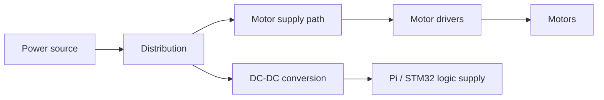

# 電源とモータ駆動系

## 設計意図

報告ではモータ負荷に伴う電圧降下と回路の不安定性に対応するため、DC-DC変換と電源分離を検討・導入したと記述されています。負荷の変動とロジックの電源品質を分けて考えた点が、回路とソフトウェアを統合する上での論点です。

これは電力系統の設計意図を表す概念図です。具体的な電圧、電流、絶縁、GNDの分離、保護部品を保証する実回路図ではありません。「電源分離」がガルバニック絶縁を意味するとも断定しません。

## 評価の観点

| 観測 | 切り分けたい原因 | 現在の記録 |
|---|---|---|
| モータ始動時の各レール電圧 | 供給不足、配線抵抗、過渡降下 | 波形なし |
| Pi / MCUのリセット | ロジック電源品質、ノイズ、ソフトウェア停止 | 回数・時刻ログなし |
| モータ電流 | 始動・拘束負荷、機構の引っ掛かり | 定量値なし |
| ドライバと変換器の温度 | 放熱、損失、連続負荷 | 長時間測定なし |
| SPIの誤動作と負荷の相関 | 信号品質、基準電位、配線干渉 | 相関データなし |

実配線でモータ電流のリターン経路と通信の基準電位を確認する必要があります。過電流・逆接・低電圧保護の回路や定格を、レイアウト画像だけから推定していません。

## ソフトウェアとの関係

電源不良、カメラ停止、SPI停止は、外からは「追従しない」という似た現象に見える可能性があります。電源電圧、プロセス状態、送信値、MCU受信値、PWMを別々に観測することで切り分けます。現在のコードには電圧・電流センサの取得や異常時PWM遮断がないため、ソフトウェア保護済みという説明はできません。

[設計時の電源論点](../docs/05-power.md) / [統合順序](../hardware/integration.md) / [回路の入口](README.md)
