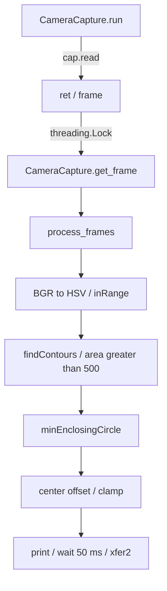

# Python — Raspberry Pi側ソフトウェア

画像の取得からSPI送信までを担当する上位ソフトウェアです。当時の実装2ファイルと、今回の資料整備で追加したハードウェア不要の通信確認ツールを分けて掲載しています。

## コードの入口

| ファイル | 内容 | 実行条件 |
|---|---|---|
| [spi/camera_spi4.py](spi/camera_spi4.py) | 黄色検出、最新フレーム共有、偏差飽和、SPI送信 | Raspberry Pi、USBカメラ、SPI、接続機器 |
| [camera/distance_camera_multithreading.py](camera/distance_camera_multithreading.py) | SPI導入前の撮像・偏差算出試作 | カメラとOpenCV環境 |
| [tools/inspect_packet.py](tools/inspect_packet.py) | 2 byte偏差の符号変換をJSONで確認 | Python標準ライブラリのみ、実機通信なし |

## 主実装の処理単位



| 関数 | 入力 | 出力・副作用 |
|---|---|---|
| `CameraCapture.run()` | カメラ | 読み取り成功時に最新フレームを置き換える |
| `get_frame()` | 共有状態 | Lock区間で `ret, frame` を取得する |
| `process_frames()` | 最新フレーム | 面積条件を満たす各輪郭について偏差を表示しSPI送信する |
| `stop()` | 終了要求 | 撮像ループのフラグを変更しカメラを解放する |

1フレーム1目標の保証はなく、対象なしのときも停止コマンドを送りません。カメラ失敗時の古いフレーム利用、ビジーループ、終了処理の課題は[並行処理](../docs/08-concurrency.md)と[故障分析](../docs/11-troubleshooting.md)を参照してください。

## 依存パッケージ

[requirements.txt](requirements.txt) はソースのimportから整理した依存一覧です。当時のバージョン固定記録ではなく、実機で再確認が必要です。`spidev` はLinuxのSPIデバイス用です。

```sh
python -m pip install -r python/requirements.txt
```

当時のスクリプトはファイル末尾で直ちにカメラを起動し、主実装はimport時にもSPIを開きます。ライブラリとしてimportして動作確認する構成ではありません。実機実行の前に[開発ガイド](../docs/development-guide.md)と[信号定義](../electronics/interfaces.md)を確認してください。

## 実機を使わず読める通信データ

リポジトリのルートから実行します。

```sh
python python/tools/inspect_packet.py encode -51 -39
python python/tools/inspect_packet.py decode 205 217
python -m unittest discover -s tests -v
```

1つ目は `wire_bytes: [205, 217]`、2つ目は `offset: [-51, -39]` を出力します。これは既存コードのデータ表現を確認するために追加したツールで、SPI転送、カメラ処理、モータ出力を実行しません。実験結果や通信の成功率を生成する機能もありません。

[画像処理の詳細](../docs/07-vision-pipeline.md) / [SPI仕様](../docs/06-spi-protocol.md) / [全体概要](../OVERVIEW.md)
